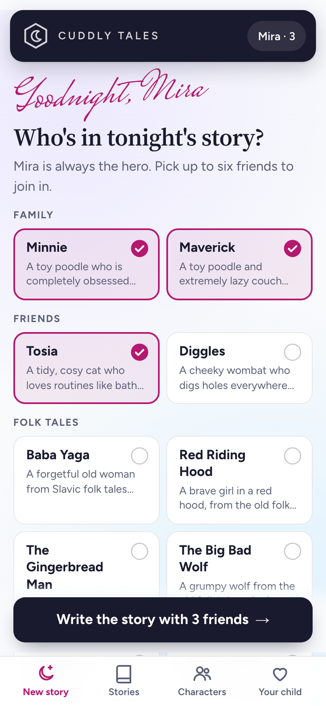
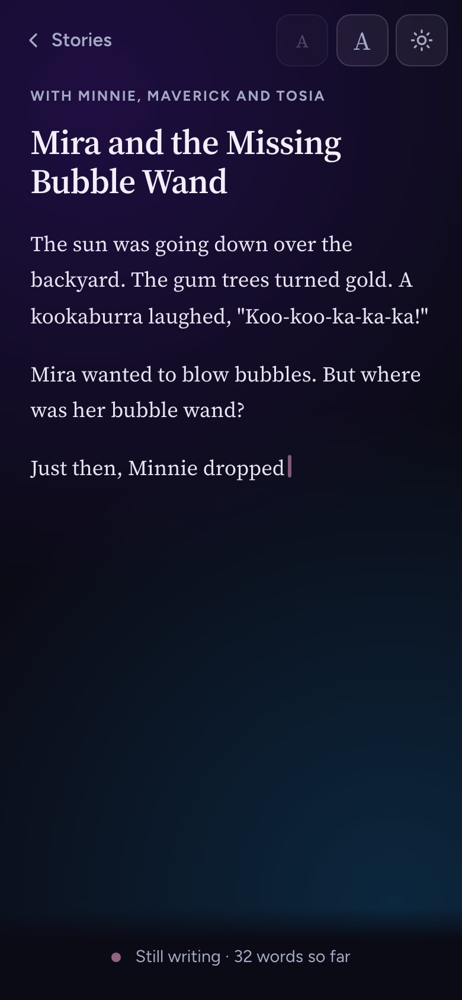
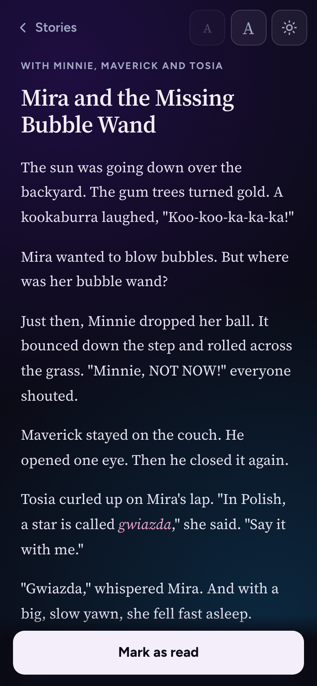
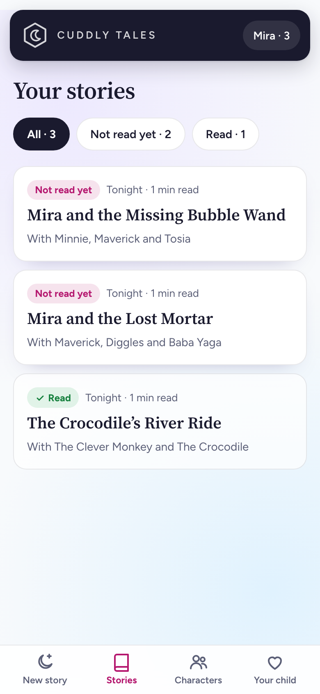

# Cuddly Tales

Gentle stories for young children (ages 2–6), with the child as the hero alongside their family,
pets, original characters and public-domain folklore. A parent picks the cast and whether it's for
any time of day or bedtime, and the story is written by an LLM and streamed to the screen word by
word, ready to read aloud.

**Live: https://cuddly-tales.ukdoshi.com** (public; new stories are capped at 30 a day)

<p>
  
  
  
  
</p>

Designed for a parent's phone, in the style of [ukdoshi.com](https://ukdoshi.com): pick the cast,
watch the story arrive, then read it aloud in large type. Bedtime stories end calm and sleepy and open
in night mode; the whole site has a light and a dark theme.

> Built for a take-home assessment over three days. Day 1 is done; this README grows with each
> feature, and the table below shows what's in place and what's next.

## What it does

The assessment asks for at least three of five capabilities; Cuddly Tales aims for all five.

| Requirement | Status | How it's met |
| --- | --- | --- |
| **1. CRUD** | Done | Characters and stories can be created, viewed, edited and deleted, and are saved in Postgres. Stories can be marked read, and hearted to keep them under Favourites. The child's profile (name, age, favourite things) can be edited too; a new name is also changed in every story and character that used the old one. Deleting a character keeps the stories it was in. |
| **2. In-app analytics** | Day 3 | A dashboard with charts from real app data (stories read, character appearances, Polish words learned). |
| **3. Drag and drop** | Day 3 | A storyboard of plot cards that can be reordered, with the order saved. |
| **4. Streaming and scheduled work** | Streaming done; schedule Day 3 | Stories stream word by word over Server-Sent Events, live through CloudFront and Lambda. An EventBridge job at 18:30 (Melbourne) will prepare tonight's chapter, with a "Run now" button. |
| **5. AI agent** | Day 2 | "Plan a 5-night adventure for Mira": an agent that uses tools step by step, with every step shown live. |

The demo family is Mira (3) and her cast: two toy poodles, Minnie and Maverick, Tosia the cat,
Diggles the wombat, and characters from public-domain folklore and the Panchatantra. Each character
has running jokes the story always follows, like Minnie chasing her ball while everyone shouts
"Minnie, NOT NOW!".

## The safety and age check

Every new story is checked before it's saved, as soon as it finishes streaming:

1. **Plain rules** (code, always the same answer): the length suits the child's age (about 300–600
   words at 3), there's a title, and none of a short list of frightening words appears.
2. **An LLM judge** (the same model, asked for a structured JSON verdict): scariness from 1 to 5
   (a story passes at 2 or below), whether the reading level suits the child's age, whether every
   character keeps their running-joke rules, whether everyone stays who they are (a cat isn't turned
   into a grandma), whether the ending is right (calm and sleepy for bedtime), and whether the story
   is new: not a repeat of, or too similar to, any of the family's last 30 stories. Any problems come
   back as short sentences a parent can read, with a one-sentence summary of what happens.

**Every story is new.** Before writing, the prompt lists the stories told so far (title and that
summary) and asks for a different main problem; the code also picks a kind of plot at random (a
surprise to prepare, building something, a visit somewhere new…), so the model doesn't keep falling
back on "something is lost". Running jokes stay small moments, never the whole plot. The check then
enforces it: a story too similar to an earlier one fails and is rewritten.

If the story fails, it's **rewritten once**, with the problems as feedback, and the rewrite streams
in place of the first version. If that fails too (or the check itself can't run), the story is
saved but marked **"Read first"**: the reading page lists what the check found, and a parent can
approve it, edit it or delete it. A story is never treated as safe without a check.

Each story keeps the full report (scores and problems for every version), so the dashboard can show
how often stories pass first time. One trade-off: the first version streams before it's checked,
because holding it back would remove the word-by-word streaming. The prompt sets the same limits,
the check runs within seconds of the end, and a failed story is replaced.

Tests never call the real model: a test fixture makes any unfaked model call fail.

## Architecture


Live, the Angular app is served from S3 through CloudFront, and `/api/*` goes to FastAPI on AWS
Lambda through a streaming Function URL (see [Deployment](#deployment)). Locally, one FastAPI process
can serve both. On the streaming path (amber), the LLM sends token chunks through LiteLLM, the story service
regroups them into whole words, and Server-Sent Events carry each word to the browser. Dashed parts
come later.


The story row is created before any text arrives, so the stream has an id to save into. The full
text is saved once, when the model finishes and the [safety check](#the-safety-and-age-check) has run. If generation fails, the browser gets an `error` event
and the story stays `planned`, so nothing half-written is kept.

A version with captions and progress so far is in [docs/architecture.html](docs/architecture.html).

## Run it locally

You need Python 3.13 and Node.js with npm. The Angular CLI is installed with the frontend packages.

```bash
# 1. Settings: copy the example and add your LLM API key
cp .env.example .env

# 2. Backend (FastAPI on http://localhost:8000)
cd backend
python3.13 -m venv .venv
.venv/bin/pip install -r requirements-dev.txt
.venv/bin/uvicorn app.main:app --reload

# 3. Frontend (Angular on http://localhost:4200, forwards /api to the backend)
cd frontend
npm install
npm start
```

Open http://localhost:4200. On first start the database (`backend/cuddly_tales.db`) is created
and seeded with the demo family: Mira (3) and her cast.

### Run it as one process

FastAPI can also serve the built Angular app, the way a single server would:

```bash
cd frontend && npm run build
cd ../backend && .venv/bin/uvicorn app.main:app
```

Then open http://localhost:8000.

## Tests

```bash
cd backend && .venv/bin/pytest        # API tests, with the LLM faked (no API key needed)
cd frontend && npx ng test --watch=false
```

GitHub Actions runs both on every pull request, and again before every deploy.

### Changing the database

Tables are managed with [Alembic](https://alembic.sqlalchemy.org). The app runs any new migrations
when it starts, locally and on Lambda. After changing a model in `backend/app/models.py`, add a
migration and check it in:

```bash
cd backend
.venv/bin/alembic revision --autogenerate -m "add plot cards"   # writes app/migrations/versions/...
```

Read the generated file before committing. A test (`tests/test_migrations.py`) fails if the models
and the migrations ever disagree.

## Configuration

All settings are environment variables, documented in [.env.example](.env.example).

| Variable | What it does |
| --- | --- |
| `LLM_MODEL` | Model name in LiteLLM format, e.g. `anthropic/claude-opus-5-5` |
| `ANTHROPIC_API_KEY` | API key for the model's provider |
| `LLM_REASONING_EFFORT` | How long the model thinks before writing (`low` starts the story sooner) |
| `MAX_STORIES_PER_DAY` | New stories allowed in any 24 hours across the site (default 30; 0 = no limit) |
| `DATABASE_URL` | SQLite locally; a Postgres URL in production |

## Deployment

Live at **https://cuddly-tales.ukdoshi.com**, on AWS, in the same account and with the same
patterns as [ukdoshi.com](https://github.com/uttydoshi/ukdoshi-site) and
[lab.ukdoshi.com](https://github.com/uttydoshi/ukdoshi-lab). Everything is defined with the AWS CDK
in [`infra/`](infra).

| | |
| --- | --- |
| **Frontend** | Angular, in a private S3 bucket served through CloudFront |
| **API** | FastAPI on AWS Lambda (Python 3.13, arm64), run by the [Lambda Web Adapter](https://github.com/awslabs/aws-lambda-web-adapter) behind a streaming Function URL, so stories stream word by word. CloudFront adds a secret header and the API refuses requests without it. |
| **Database** | Neon Postgres (us-east-1), with Alembic migrations run when the API starts |
| **Secrets** | The Claude key and database URL in AWS Secrets Manager, set with `scripts/` |
| **DNS and HTTPS** | `cuddly-tales.ukdoshi.com` in the existing Route 53 zone, with an ACM certificate, both made by the CDK |
| **CI/CD** | GitHub Actions: tests on every pull request; on `main`, tests, build and `cdk deploy`, logging in to AWS with OIDC |
| **Cost guards** | No sign-in, so new stories are capped at 30 a day, and the Claude key has its own spend limit |

There is one live copy. A staging copy would be one more `Stage` in
[`infra/stacks/stage.py`](infra/stacks/stage.py) and a branch in the workflow.

### One-time setup (owner)

These need AWS access to the account (an SSO profile called `ukdoshi`). The account already has
the CDK bootstrap, the `ukdoshi.com` zone and GitHub's sign-in provider from ukdoshi-site.

```bash
aws sso login --profile ukdoshi
export AWS_PROFILE=ukdoshi

scripts/claude-key.sh      # paste a Claude key made just for Cuddly Tales
scripts/database-url.sh    # paste Neon's pooled connection URL

cd infra
python3.13 -m venv .venv && .venv/bin/pip install -r requirements.txt
cdk deploy CuddlyTalesGithubDeploy    # the role GitHub Actions deploys with
```

After that, merging to `main` deploys. Running a script again replaces that secret and restarts
the API.
