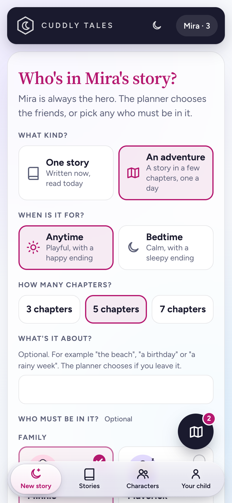
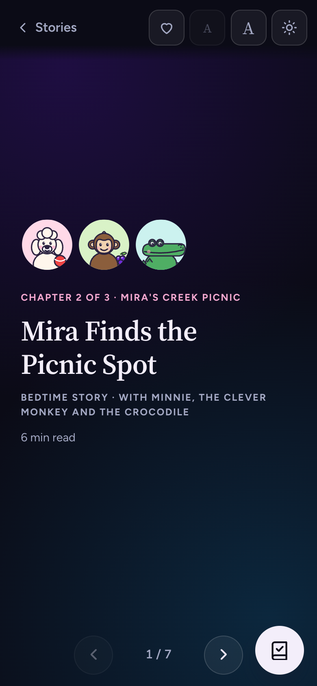
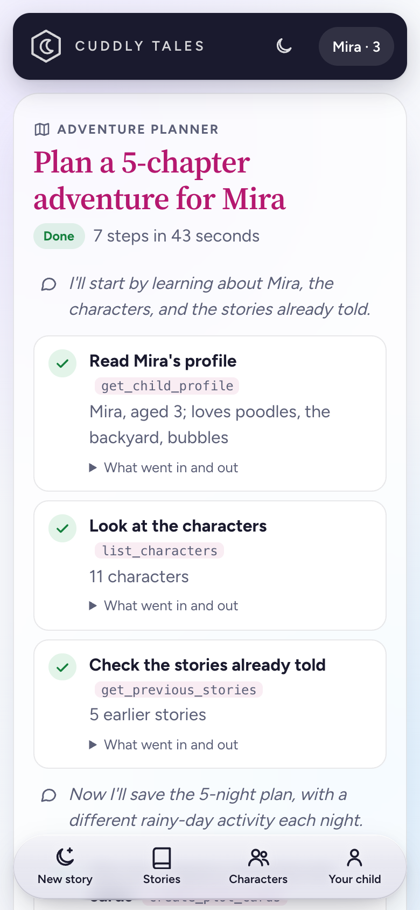

# Cuddly Tales

Gentle stories for young children (ages 2–6), with the child as the hero alongside their family,
pets, original characters and public-domain folklore. A parent picks the cast and whether it's for
any time of day or bedtime, and the story is written by an LLM and streamed to the screen word by
word, ready to read aloud.

**Live: https://cuddly-tales.ukdoshi.com** (public; new stories are capped at 30 a day)

<p>
  
  
  
  
  
</p>

Designed for a parent's phone, in the style of [ukdoshi.com](https://ukdoshi.com): pick the cast,
watch the story arrive, then read it aloud in large type, page by page like an e-reader: a cover with
the title, then the story, turned with the arrows, a swipe, a tap on the page's edge or the arrow keys
(two pages side by side on wide screens). Bedtime stories end calm and sleepy and open in night mode;
the whole site has a light and a dark theme.

> Built for a take-home assessment over three days. Days 1 and 2 are done and live; Day 3 (the
> storyboard, the dashboard, the scheduled chapter and evals) is next. The table below shows what's
> in place.

## What it does

The assessment asks for at least three of five capabilities; Cuddly Tales aims for all five.

| Requirement | Status | How it's met |
| --- | --- | --- |
| **1. CRUD** | Done | Characters and stories can be created, viewed, edited and deleted, and are saved in Postgres. Stories can be marked read, and hearted to keep them under Favourites. The child's profile (name, age, favourite things) can be edited too; a new name is also changed in every story and character that used the old one. Deleting a character keeps the stories it was in. |
| **2. In-app analytics** | Day 3 | A dashboard with charts from real app data (stories read, character appearances, Polish words learned). |
| **3. Drag and drop** | Day 3 | A storyboard of plot cards that can be reordered, with the order saved. |
| **4. Streaming and scheduled work** | Streaming done; schedule Day 3 | Stories stream word by word over Server-Sent Events, live through CloudFront and Lambda. An EventBridge job at 18:30 (Melbourne) will prepare the next chapter of an adventure, with a "Run now" button. |
| **5. AI agent** | Done | "Plan a 5-chapter adventure for Mira": the model works through the goal with 7 tools, choosing each next step; every step is saved and streamed live. See [The adventure agent](#the-adventure-agent). |

The demo family is Mira (3) and her cast: two toy poodles, Minnie and Maverick, Tosia the cat,
Diggles the wombat, and characters from public-domain folklore and the Panchatantra. Each character
has running jokes the story always follows, like Minnie chasing her ball while everyone shouts
"Minnie, NOT NOW!".

## The safety and age check

Every new story is checked before it's saved, as soon as it finishes streaming:

1. **Plain rules** (code, always the same answer): the length suits the child's age (about 300–600
   words at 3), there's a title, and none of a short list of frightening words appears.
2. **An LLM judge** (the same model, asked for a structured JSON verdict): scariness from 1 to 5
   (a story passes at 2 or below), whether the reading level suits the child's age, whether every
   character keeps their running-joke rules, whether everyone stays who they are (a cat isn't turned
   into a grandma), whether the ending is right (calm and sleepy for bedtime), and whether the story
   is new: not a repeat of, or too similar to, any of the family's last 30 stories. Any problems come
   back as short sentences a parent can read, with a one-sentence summary of what happens.

**Every story is new.** Before writing, the prompt lists the stories told so far (title and that
summary) and asks for a different main problem; the code also picks a kind of plot at random (a
surprise to prepare, building something, a visit somewhere new…), so the model doesn't keep falling
back on "something is lost". Running jokes stay small moments, never the whole plot. The check then
enforces it: a story too similar to an earlier one fails and is rewritten.

If the story fails, it's **rewritten once**, with the problems as feedback, and the rewrite streams
in place of the first version. If that fails too (or the check itself can't run), the story is
saved but marked **"Read first"**: the reading page lists what the check found, and a parent can
approve it, edit it or delete it. A story is never treated as safe without a check.

Each story keeps the full report (scores and problems for every version), so the dashboard can show
how often stories pass first time. One trade-off: the first version streams before it's checked,
because holding it back would remove the word-by-word streaming. The prompt sets the same limits,
the check runs within seconds of the end, and a failed story is replaced.

Tests never call the real model: a test fixture makes any unfaked model call fail.

## The adventure agent

A parent asks for an adventure (3 to 7 chapters, one a day, for bedtime or any time; optionally with characters who must be in it and a
theme). The agent gets the goal "Plan a 5-chapter adventure for Mira, then write, check and save
chapter 1" and seven tools:

| Tool | What it does |
|---|---|
| `get_child_profile`, `list_characters`, `get_previous_stories` | Read the child, the cast and the stories already told |
| `create_plot_cards` | Save the plan: a title, a premise, and each chapter's title, characters and plot cards |
| `write_chapter` | Write a chapter from its plot cards (the story prompt, plus the chapters so far); called again after a failed check, it rewrites it |
| `safety_check` | The same safety and age check as every story |
| `save_story` | Save the checked chapter |

It's a real loop: the model chooses which tool to call next (LiteLLM tool calling), the code runs
it and returns the result, until the model says it's done. A typical run takes about 40 seconds and
10 tool calls. Before each call the model says in one sentence what it's doing; that sentence and
each tool's result are saved as steps and streamed to the parent's screen as they happen: a
live timeline with the tool names, timings, and what went in and out of each tool, then the plan,
chapter by chapter, with its plot cards. Each chapter shows in the stories list as "Chapter 2 of 5".

**The rules live in the tools, not only the prompt**, so a confused model can't break them: only
characters that exist, every character the parent asked for, exactly the chapters asked for, 2 to 6
plot cards a chapter; only the next chapter is written in a run; nothing is saved before its check; a
chapter that fails is rewritten (once) before it's saved, then saved as "Read first" if it still
fails. A refused call is reported back to the model, which can correct itself. A run is capped at
25 tool calls and 4 minutes (Lambda stops a request at 5), and the parent's theme is passed as a
topic only. Planned chapters don't count towards the daily story cap; each run does.

**One chapter per run.** The plan run writes chapter 1; each later chapter is its own run, started
by the evening scheduled job or a parent's "Write chapter 2 now". Writing every chapter in one go
would take several minutes, close to Lambda's limit, and each chapter still needs its own check.

## Tracing with Langfuse

Every model call is traced in [Langfuse](https://langfuse.com), so any story or agent run can be
looked into afterwards: what the model was asked, what it said, tokens, cost and time.

| Trace | Steps inside it |
|---|---|
| `story`: one per story written | `write`, `safety-check`, and `rewrite` + `safety-check` if it failed |
| `adventure-agent`: one per agent run | `agent-turn-1`, `agent-turn-2`… (each choice of tool), `write-chapter`, `safety-check`, and `rewrite-chapter` if it failed |

Traces are in Langfuse's environment `live` or `local` (where the app ran), are tagged with the feature and that place, carry the story or
run id, and an adventure's runs share a Langfuse session, so all its chapters can be followed
together. All model calls go through `backend/app/services/llm.py`, which is the only code that
knows about tracing.

**How it's sent:** through LiteLLM's OpenTelemetry integration for Langfuse (`langfuse_otel`), to
Langfuse's OpenTelemetry endpoint: the route Langfuse's own SDK uses, and an open standard, so the
same spans could go to another tracing tool. Three details make it work on Lambda:
- **One trace per story or run, with a root.** Langfuse groups spans by their OpenTelemetry trace,
  and lists traces (and filters them by tag and environment) by each trace's root. LiteLLM only
  sends the model calls, so the app sends a root span for each story or run: it names the trace and
  carries its tags, environment and session, and every model call hangs under it.
- **Sent before the response ends.** Lambda freezes the process as soon as a response is done.
  After a model call, LiteLLM hands its logging to a background queue and the spans wait in a
  batch, so `tracing.flush()` waits for the hand-off, runs the queue, then sends the batch.
- **Costs.** The pinned LiteLLM's price list predates Opus 5.5, so its price is registered from a
  later LiteLLM release's list; otherwise every call would show $0.

LiteLLM is also kept from loading a `.env` file of its own (`LITELLM_MODE=PRODUCTION`): the app
loads its settings itself, and LiteLLM's search was quietly putting keys back into the tests.

**What's sent:** prompts include the child's first name, age and favourite things, and replies are
the stories. They go to a private Langfuse project (US region) that only the owner can see,
because that's what makes a failed safety check debuggable. `LANGFUSE_LOG_CONTENT=false` sends
only timings, tokens and cost. Without Langfuse keys, nothing is sent at all (and tests never send
anything).

## Responsible AI

**Guardrails.** Every story passes the [safety and age check](#the-safety-and-age-check) (plain rules
plus an LLM judge) before it counts as safe: a failure is rewritten once, and if it still fails, or
the check can't run, the story is saved as "Read first" for a parent. The adventure agent can't skip
any of this: its rules live in its tools (real characters only, nothing saved before its check, one
rewrite), not just in its prompt, and a parent's theme is passed as a topic, never as instructions.
The prompts set the limits too: the child is the hero, nothing frightening, simple words, a warm
ending (sleepy at bedtime).

**Content rights.** Only original characters and public-domain folklore (Baba Yaga, Red Riding Hood,
the Gingerbread Man, the Panchatantra). The prompt forbids characters from films, TV, games and
modern books, and nothing copyrighted is in the repo. Characters a parent adds are their own data,
kept in the app's database and never committed.

**Child privacy.** No sign-in and one family per deployment. The app stores the child's first name,
age and favourite things, nothing more, and no photos. Prompts (with that name) and stories are
traced to a private Langfuse project that only the owner can see; `LANGFUSE_LOG_CONTENT=false` sends
only timings, tokens and cost. The demo family is made up; no real children's names or photos are in
the repo.

**A parent stays in control.** The parent picks the cast and the kind of story, can read, edit or
delete any story or character, approves anything the check flagged, and sees every step the agent
takes. Adventures are written one chapter at a time, so nothing piles up unread.

**Known limits.** The first version of a story streams before it's checked, because holding it back
would lose the word-by-word streaming; a failed story is replaced within seconds. An LLM judge can be
wrong, so it's backed by plain rules and, on Day 3, by evals with fixed expectations. The site is
public, so new stories are capped at 30 a day and the Claude key has its own spend limit.

## Architecture


Live, the Angular app is served from S3 through CloudFront, and `/api/*` goes to FastAPI on AWS
Lambda through a streaming Function URL (see [Deployment](#deployment)). Locally, one FastAPI process
can serve both. On the streaming paths (amber), the LLM sends token chunks through LiteLLM, the story
service regroups them into whole words, and Server-Sent Events carry each word to the browser; the
planner page streams the agent's steps the same way. Every model call goes through `llm.py`, which
traces it in Langfuse. The dashed part (the 18:30 scheduled chapter) comes on Day 3.


The story row is created before any text arrives, so the stream has an id to save into. The full
text is saved once, when the model finishes and the [safety check](#the-safety-and-age-check) has run. If generation fails, the browser gets an `error` event
and the story stays `planned`, so nothing half-written is kept.

A version with captions and progress so far is in [docs/architecture.html](docs/architecture.html).

## Run it locally

You need Python 3.13 and Node.js with npm. The Angular CLI is installed with the frontend packages.

```bash
# 1. Settings: copy the example and add your LLM API key
cp .env.example .env

# 2. Backend (FastAPI on http://localhost:8000)
cd backend
python3.13 -m venv .venv
.venv/bin/pip install -r requirements-dev.txt
.venv/bin/uvicorn app.main:app --reload

# 3. Frontend (Angular on http://localhost:4200, forwards /api to the backend)
cd frontend
npm install
npm start
```

Open http://localhost:4200. On first start the database (`backend/cuddly_tales.db`) is created
and seeded with the demo family: Mira (3) and her cast.

### Run it as one process

FastAPI can also serve the built Angular app, the way a single server would:

```bash
cd frontend && npm run build
cd ../backend && .venv/bin/uvicorn app.main:app
```

Then open http://localhost:8000.

## Tests

```bash
cd backend && .venv/bin/pytest        # API tests, with the LLM faked (no API key needed)
cd frontend && npx ng test --watch=false
```

GitHub Actions runs both on every pull request, and again before every deploy. Tests never call
the model or send traces. A few guard against live-only failures found along the way: one builds
each kind of model request for real (stopped before it's sent) and fails if the Lambda build deleted
anything it needs, or if it forces a tool call current Claude models reject.

LiteLLM is pinned (1.91.5, the newest with Linux arm64 wheels, which is what Lambda gets) so local,
CI and Lambda run the same version. When dependencies change, run the tests in a fresh virtualenv
built only from `requirements-dev.txt`, as CI and Lambda do.

### Changing the database

Tables are managed with [Alembic](https://alembic.sqlalchemy.org). The app runs any new migrations
when it starts, locally and on Lambda. After changing a model in `backend/app/models.py`, add a
migration and check it in:

```bash
cd backend
.venv/bin/alembic revision --autogenerate -m "add plot cards"   # writes app/migrations/versions/...
```

Read the generated file before committing. A test (`tests/test_migrations.py`) fails if the models
and the migrations ever disagree.

## Configuration

All settings are environment variables, documented in [.env.example](.env.example).

| Variable | What it does |
| --- | --- |
| `LLM_MODEL` | Model name in LiteLLM format, e.g. `anthropic/claude-opus-5-5` |
| `ANTHROPIC_API_KEY` | API key for the model's provider |
| `LLM_REASONING_EFFORT` | How long the model thinks before writing (`low` starts the story sooner) |
| `MAX_STORIES_PER_DAY` | New stories allowed in any 24 hours across the site (default 30; 0 = no limit) |
| `DATABASE_URL` | SQLite locally; a Postgres URL in production |
| `LANGFUSE_PUBLIC_KEY`, `LANGFUSE_SECRET_KEY`, `LANGFUSE_HOST` | Langfuse project keys and region; tracing is off without them |
| `LANGFUSE_LOG_CONTENT` | `false` sends only timings, tokens and cost to Langfuse, not prompts or stories |

## Deployment

Live at **https://cuddly-tales.ukdoshi.com**, on AWS, in the same account and with the same
patterns as [ukdoshi.com](https://github.com/uttydoshi/ukdoshi-site) and
[lab.ukdoshi.com](https://github.com/uttydoshi/ukdoshi-lab). Everything is defined with the AWS CDK
in [`infra/`](infra).

| | |
| --- | --- |
| **Frontend** | Angular, in a private S3 bucket served through CloudFront |
| **API** | FastAPI on AWS Lambda (Python 3.13, arm64), run by the [Lambda Web Adapter](https://github.com/awslabs/aws-lambda-web-adapter) behind a streaming Function URL, so stories stream word by word. CloudFront adds a secret header and the API refuses requests without it. |
| **Database** | Neon Postgres (us-east-1), with Alembic migrations run when the API starts |
| **Secrets** | The Claude key, database URL and Langfuse keys in AWS Secrets Manager, set with `scripts/` |
| **Observability** | Every model call traced in Langfuse (OpenTelemetry), in the environment `live`; Lambda logs in CloudWatch |
| **DNS and HTTPS** | `cuddly-tales.ukdoshi.com` in the existing Route 53 zone, with an ACM certificate, both made by the CDK |
| **CI/CD** | GitHub Actions: tests on every pull request; on `main`, tests, build and `cdk deploy`, logging in to AWS with OIDC |
| **Cost guards** | No sign-in, so new stories are capped at 30 a day, and the Claude key has its own spend limit |

There is one live copy. A staging copy would be one more `Stage` in
[`infra/stacks/stage.py`](infra/stacks/stage.py) and a branch in the workflow.

### One-time setup (owner)

These need AWS access to the account (an SSO profile called `ukdoshi`). The account already has
the CDK bootstrap, the `ukdoshi.com` zone and GitHub's sign-in provider from ukdoshi-site.

```bash
aws sso login --profile ukdoshi
export AWS_PROFILE=ukdoshi

scripts/claude-key.sh      # paste a Claude key made just for Cuddly Tales
scripts/database-url.sh    # paste Neon's pooled connection URL
scripts/langfuse-keys.sh   # optional: paste the Langfuse project's keys to turn on tracing

cd infra
python3.13 -m venv .venv && .venv/bin/pip install -r requirements.txt
cdk deploy CuddlyTalesGithubDeploy    # the role GitHub Actions deploys with
```

After that, merging to `main` deploys. Running a script again replaces that secret and restarts
the API.

## How I used AI to build it

I built Cuddly Tales with [Claude Code](https://claude.com/claude-code) in VS Code, and used
[claude.ai](https://claude.ai) alongside it for the visual design. Claude wrote most of the code; I
decided what to build, reviewed everything before it shipped, and caught most of what went wrong by
using the app.

**The brief.** I wrote [CLAUDE.md](CLAUDE.md) before any code: the assessment requirements, the
domain model, the demo family and each character's running jokes, the content rules (no copyrighted
characters, no real children's names, age-appropriate stories), the stack, the build order and how I
wanted to work: plan before coding, small commits, a test for every endpoint, never commit secrets.
Claude refined it and kept a "Things to know" section updated with every lesson we learned, so each
new session started from what the last one found out.

**How a change went.** For anything bigger than a small fix, Claude wrote a plan first: what would
change, the trade-offs, and a recommendation. I approved it or changed it, then it was built on a
feature branch, tested in CI, and opened as a pull request. I read the plans, the PR diffs and the
screenshots Claude took on phone and desktop, in light and dark, and tried the app locally and on the
live site before saying "merge". Merging to `main` deployed it.

**Decisions I made.** Claude proposed options; these were my calls:
- **Adventures in chapters, not nights,** once I noticed "How many nights?" made no sense for a story
  read in the daytime. The rename went all the way through the database and the agent's tools.
- **Reading in pages,** like an e-reader, with the title on a cover page.
- **Every story must be new.** After seeing three stories in a row about a lost mortar, I asked for a
  general rule: check what's been told before writing, and reject anything too similar.
- **Characters stay themselves.** Tosia the cat once appeared as "Babcia Tosia" (grandma); that
  became a rule in the prompt and a check in the safety judge.
- **Small product details:** favourites, renaming the child everywhere, one word ("Unread") for
  unread stories, keeping the filters on one line.
- **What to cut.** I deferred the latte monster creator (photo to character) to keep the required
  features on track.

**Design.** I worked out the phone design and the character avatars on a design canvas in claude.ai
first, then had Claude Code build them into the app. I reviewed every avatar and sent back changes:
heads floating above their bodies, Baba Yaga needing a proper witch's hat, a wolf that looked like a
cat.

**What I did by hand.** Small edits to the prompts and to wording here and there in the app, and
all the setup and configuration of the services the app runs on:
- **AWS:** the account, SSO access and settings the CDK deploys into, and the secrets in Secrets
  Manager, stored with the scripts in `scripts/` so no key was ever pasted into a chat or a file.
- **Anthropic:** a separate workspace for Cuddly Tales with its own API key and monthly spend limit.
- **Neon:** the Postgres project and database the live site uses.
- **Langfuse:** the account, the project in the US region, and its API keys, locally and on AWS.
- My local `.env`.

**What went wrong, and how it was caught.** The most useful part of the process was what happened
when things broke:
- **"Works locally, fails live."** I noticed stories on the live site were always marked "Read
  first" and adventures failed straight away. The causes were all differences between my laptop and
  Lambda: Lambda installs an older LiteLLM than I had locally, the Lambda build deleted a folder that
  version needed, and one package was only present locally as a leftover. Each was fixed and then
  guarded by a test; LiteLLM is now pinned to the version Lambda gets, and every deploy that touches
  the model is followed by a real story on the live site.
- **A tracing bug I spotted in Langfuse:** the `live` tag never showed. The first explanation (an
  environment filter) was only part of it; the real cause was that the traces had no root, so
  Langfuse never listed them. It took asking "why" twice.
- **My local database looked empty** after a half-finished migration reloaded into my running dev
  server. The data was intact; Claude repaired it with a backup, and since then works in a separate
  git worktree so my running app never sees half-done changes.

**What I'd keep doing.** Writing the brief first, insisting on a plan before code, and checking the
real thing (the live site, real model output, real traces) rather than trusting green tests.

## What I'd do next

- **Families with sign-in:** accounts, each family's own child, characters and stories, and per-family
  limits instead of one site-wide cap.
- **The latte monster creator:** photograph latte art and the model invents a character from its
  shape, for a parent to approve. The photo would be sent to the model and not stored.
- **Cheaper agent runs:** each agent turn resends the whole conversation (about 1,800 tokens on the
  first turn, 5,000 by the last); prompt caching would cut the cost of an adventure noticeably.
- **A staging copy:** one more stage in the CDK and a branch in the workflow, so changes are checked on
  AWS before the live site.
- **Evals that keep running:** run the evals on a schedule against the live model, and send the safety
  check's scores to Langfuse, to see drift over time.
- **Read aloud:** audio for each page, and a Polish-only mode for grandparents.
